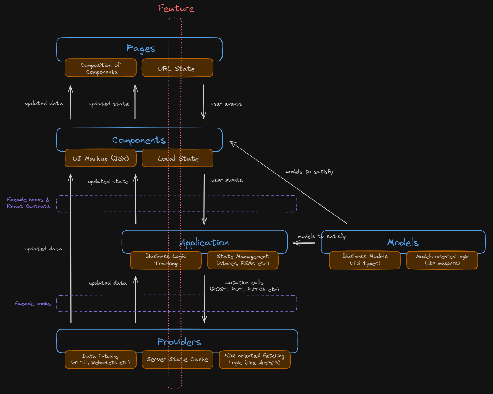

# Architecture

## Core Technologies

- **React 19** with TypeScript
- **Vite 8** for build tooling
- **React Query (TanStack Query)** for data fetching
- **React Router 8** for routing
- **i18next** for internationalization
- **MSW 2** for API mocks
- **Vitest 4** for unit and component tests
- **Storybook 10** for component development
- **Playwright** for E2E tests
- **Zustand** for state management
- **Chakra UI** for components

## Project Structure

```
.
├── e2e/           # End-to-end tests with Playwright
└── src/
    ├── app/           # App-level configuration (App.tsx, Providers.tsx)
    ├── features/      # Feature modules using feature slice architecture
    │   ├── auth/      # Authentication feature (cross-cutting concern)
    │   ├── carts/     # Shopping cart feature
    │   ├── products/  # Product catalog feature
    │   └── marketing/          # Feature with sub-feature slices
    │       ├── components/     # Marketing-wide components
    │       ├── providers/      # Marketing-wide providers
    │       ├── models/         # Marketing-wide models
    │       ├── rating/         # Sub-feature slice
    │       │   ├── components/
    │       │   ├── application/
    │       │   ├── providers/
    │       │   └── models/
    │       └── reviews/        # Sub-feature slice
    │           ├── components/
    │           ├── application/
    │           ├── providers/
    │           └── models/
    ├── lib/           # Shared libraries and utilities
    │   ├── api/       # Centralized API layer (queries, mutations, DTOs)
    │   ├── components/ # Reusable UI components
    │   ├── http/      # HTTP client and error handling
    │   ├── i18n/      # Internationalization setup
    │   ├── router/    # Routing utilities
    │   └── theme/     # Theme configuration
    ├── pages/         # Route-level page components composing feature components & logic
    └── test-lib/      # Testing utilities and fixtures
```

## Feature Architecture

Each feature uses the patterns of the feature slice architecture, with four layers:

- **components/** - UI components. They are presentational and decoupled from business logic (application) and from
  router state. They get data only through `providers/`.
- **application/** - Business logic, portable state management (stores, FSMs, form validation), custom hooks. This
  layer should not depend directly on router state or external APIs. It uses them only through `providers/`.
- **providers/** - Hook composition and the data access gateway of the feature slice. This layer exposes query hooks,
  mutations, loaders, and domain errors that come from `src/lib/api/`. When the DTO shape is different from the domain
  model, the mapping function is here. The query or mutation hook applies it, so that consumers always receive the
  correct type of domain model.
  - The name of a file is the name of its primary export or re-export: `useCartProductsQuery` →
    `use-cart-products-query.ts`, `useAddToCartMutation` → `use-add-to-cart-mutation.ts`.
  - Provider hooks get all their dependencies (ids, filters) as parameters and never read React context. Thus, you can
    call them from any tree, and you can test them without extra providers.
- **models/** - Only definitions of domain types. This layer exposes the frontend models of the feature. When the DTO
  shape is the same as the domain model, re-export it with a domain name (`export type { ProductDto as Product }`).
  When the shape is different, define the domain type here.

### `application/` vs `components/`

Ask: _can this code run without React?_ If the code has no reason to exist without the UI, it belongs in
`components/`. `application/` contains the code that still has a meaning if you replace the full UI:

- domain rules
- computations on feature data
- stores and machines that live longer than a screen
- the pair of use-case hook and notification hook that controls one user-facing operation.

Some placements surprise people:

- Hooks for local UI state (dialog open or closed, active step, form defaults) are in `components/`. The exception is
  state that encodes a domain rule (which steps a flow has, and in which order). The rule goes in `application/` (a
  function, store or machine), and the component only keeps the current position.
- Label hooks that change a domain enum into translated strings are in `components/`.
- Filter and selector functions that only decide what to render are in `components/`. UI configs (table columns, cell
  renderers) are also in `components/`.

### Dependency rule

| Layer          | Can import from                                  |
| -------------- | ------------------------------------------------ |
| `components/`  | `application/`, `providers/`, `models/`, `lib/*` |
| `application/` | `providers/`, `models/`, `lib/*`                 |
| `providers/`   | `models/`, `lib/api/`, `lib/*`                   |
| `models/`      | `lib/api/`, `lib/*`                              |

**Cross-slice primitives:** `features/auth/` and `features/authv2/` are cross-cutting concerns (identity, permissions,
auth state). All feature slices can import from them.

```text
┌──────────────────────────────────────────────────────────────────────┐
│         components/  (UI, presentational, no business logic)         │
└────────────────────────┬──────────────────────┬──────────────────────┘
                         │                      │
                         ▼                      ▼
┌───────────────────────────────────┐ ┌─────────────────────────────────────────┐
│  application/  (hooks, FSMs,      │ │  providers/  (query/mutation hooks,     │
│  stores, form validation)         │ │  DTO → domain mapping)                  │
└──────────────────┬────────────────┘ └───────────────┬─────────────────────────┘
                   └──────────────┬───────────────────┘              │
                                  ▼                                  │
                   ┌──────────────────────────────┐                  │
                   │ models/  (domain types only) │                  │
                   └──────────────────────────────┘                  │
                                                                     ▼
                                                   ┌─────────────────────────────┐
                                                   │  lib/api/  (queryOptions,   │
                                                   │  mutations, DTOs)           │
                                                   └─────────────────────────────┘
```



### Sub-feature Slices

When a feature grows and contains many different domain sub-areas, each sub-area becomes a **sub-feature slice**. A
sub-feature slice is a nested directory with its own structure of four layers (`components/`, `application/`,
`providers/`, `models/`).

The layers of the parent feature contain code that sub-feature slices share, or code that is too small for its own
sub-feature slice.

The same layer dependency rules apply in sub-feature slices. Also, sub-feature layers can import from the same or lower
layers of the parent feature. Sub-feature slices **cannot import from sibling sub-feature slices**. Parent feature
layers **cannot import from their sub-feature slices**. Dependencies point only from the sub-feature to the parent, and
pages compose the two.

The reason for one direction: two modules that import each other behave as one module. You cannot change or test one
of them alone, and the imports can make cycles. The parent contains what many sub-features share, so it is stable.
Sub-features contain specific behavior, and they change frequently. Specific code depends on general code, never the
opposite.

<!-- AIDEV-NOTE: revisit when a parent shell (tabs/layout) composing sub-features is reused by 2+ pages — then allow parent `components/` → a sub-feature's top-level component only. -->

```text
features/marketing/
├── components/     ← shared across sub-features
├── providers/      ←┐ parent layers accessible
├── models/         ←┘ from sub-features (same/lower only)
│
├── rating/         ✗ cannot import from reviews/
│   ├── components/
│   ├── application/
│   ├── providers/
│   └── models/
│
└── reviews/        ✗ cannot import from rating/
    ├── components/
    ├── application/
    ├── providers/
    └── models/
```

## API Library

`src/lib/api/` is the global location for all HTTP logic: `queryOptions` factories, loaders, mutation hooks, query
keys, domain errors, and DTOs, organized by resource. Query files expose `queryOptions` factories. They do not expose
`useQuery` hooks, because hook composition belongs in `providers/`. Feature `providers/` compose hooks on top of these
factories and re-export them for the feature slice. New API logic always goes first in `src/lib/api/`. Then the
`providers/` of the related feature expose it.

**File names in `src/lib/api/`:**

| Type             | Suffix           | Example                   |
| ---------------- | ---------------- | ------------------------- |
| Query options    | `-query.ts`      | `cart-products-query.ts`  |
| Mutation options | `-mutation.ts`   | `add-to-cart-mutation.ts` |
| DTO interface    | `-dto.ts`        | `cart-product-dto.ts`     |
| Query keys       | `-query-keys.ts` | `cart-query-keys.ts`      |

```text
src/lib/api/
  cart-products-query.ts   (queryOptions factory)
  add-to-cart-mutation.ts  (mutationOptions factory)
  cart-product-dto.ts      (DTO types)
         │
         ▼
features/carts/providers/
  use-cart-products-query.ts   (composes hook + maps DTO → domain model)
  use-add-to-cart-mutation.ts
         │
         ▼
features/carts/components/
  CartList.tsx   (consumes only through providers/)
```

**Clients without HTTP** (a vendor SDK with its own transport, WebSocket, clipboard, file download) get an owned
wrapper in `src/lib/`. For these clients, tests use a mock only for that wrapper.

**APIs that we do not own.** DTOs are beliefs, written by hand, about the contract of another party. When the backend
is not ours and you cannot trust its shape, validate the response in the `lib/api/` factory before it leaves the layer.
When an OpenAPI spec exists, prefer generated DTO types.

## Key Patterns

| Pattern               | Description                                                    |
| --------------------- | -------------------------------------------------------------- |
| Co-location           | Related files (component + story + test) are in the same place |
| MSW handlers          | All API mocks are in `test-lib/handlers/`                      |
| Fixture pattern       | Test data generation is in `test-lib/fixtures/`                |
| Strong typing         | Complete TypeScript types with branded types                   |
| Component Composition | Features export composed components for pages                  |
| Centralized API       | All API logic is in `src/lib/api/`, organized by endpoint      |

## State Management

| Type           | Use Case                                                                                                             |
| -------------- | -------------------------------------------------------------------------------------------------------------------- |
| XState         | State orchestration with explicit states and constrained transitions (for example, auth flows, multi-step processes) |
| Zustand stores | Complex local state (auth, modals, and more)                                                                         |
| React Query    | Server state and caching                                                                                             |
| React state    | Simple component state                                                                                               |

We prefer XState for business processes where the states must be explicit and the transitions constrained.

Do not copy server data into a store or context. Read it through its query hook where you need it.

## Internationalization

- Translation files are in `public/locales/{lang}/translation.json`.
- Keys mirror the feature path, for example `features.products.<key>`.
- All user-facing text goes through i18next. Components contain no hardcoded strings.
- When you add a value that shows as a user-facing label, add its translation key in the same task.
- When you remove a value, remove its old translation key.

## Routing

- **File-based routing** - Pages are in `src/pages/`, with their loaders.
- **Strong typing** - Route paths are defined in `lib/router/routes.ts`.
- **Lazy loading** - Components load on demand, with error boundaries.
- **Router state stays at the top** - Read route params and search params in `pages/` (or in one thin component at the
  top of a feature), and send them down as props. Report navigation intent through callbacks. `application/` and
  `providers/` never read the router.

## Error Handling

- `src/lib/api/` factories change transport errors into domain error classes and log them. All code above branches on
  the class, never on the status or the message.
- Mutations use `UnknownError` as the fallback. Queries throw unmapped errors again without change, so that generic
  error pages still handle them.
- We use `react-error-boundary` for unexpected runtime errors in components.

## Testing

Refer to [tests/README.md](./tests/README.md) for the tiers, the mocking boundary and the design-smell signals.

## No Barrels, No `utils/`

- Do not add a new `index.ts` that only re-exports, in `features/` or `lib/`. Use only direct imports. Barrels stop
  tree-shaking, hide cycles, and let sub-features reach into each other.
- Do not add `utils/` folders. A helper for one feature is in `application/`. A generic helper is in `lib/`. If a
  helper fits in neither, the abstraction has no correct location yet.

## Build Optimization

- Lazy loading and code splitting based on `react-router`
- Direct imports instead of default exports

## Architecture Checklist

Before you complete a change, check these items:

- [ ] Each new file is in the smallest slice and layer that owns it. No `utils/`, no re-export barrel.
- [ ] No import breaks the dependency rule, goes into a sibling sub-feature, or points from parent to sub-feature.
- [ ] DTO types stay in `lib/api/`, `providers/` and `models/` (aliases). Components and application see domain types.
- [ ] The DTO → domain mapping occurs one time, in the `providers/` hook.
- [ ] `lib/api/` maps transport errors to domain errors. Consumers branch on the error class.
- [ ] Provider hooks get inputs as parameters and never read React context.
- [ ] `pages/` reads the router state and sends it down.
- [ ] The `application/` code still works if you replace the UI. Use-case and notification hooks are the exception.
