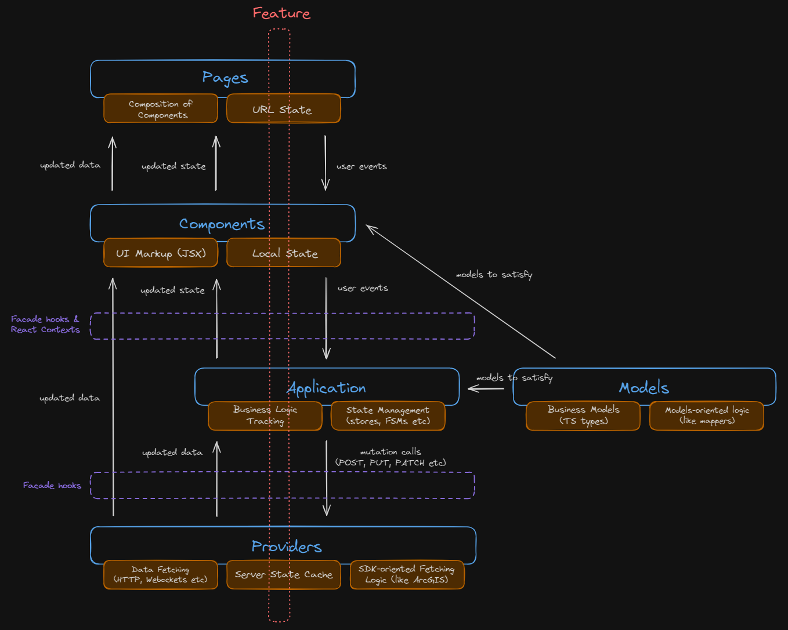

# Architecture

## Core Technologies

- **React 19** with TypeScript
- **Vite 8** for build tooling
- **React Query (TanStack Query)** for data fetching
- **React Router 8** for routing
- **i18next** for internationalization
- **MSW 2** for API mocking
- **Vitest 4** for unit and component testing
- **Storybook 10** for component development
- **Playwright** for E2E testing
- **Zustand** for state management
- **Chakra UI** for components

## Project Structure

```
.
├── e2e/           # End-to-end tests with Playwright
└── src/
    ├── app/           # App-level configuration (App.tsx, Providers.tsx)
    ├── features/      # Feature modules using feature slice architecture
    │   ├── auth/      # Authentication feature (cross-cutting concern)
    │   ├── carts/     # Shopping cart feature
    │   ├── products/  # Product catalog feature
    │   └── marketing/          # Feature with sub-feature slices
    │       ├── components/     # Marketing-wide components
    │       ├── providers/      # Marketing-wide providers
    │       ├── models/         # Marketing-wide models
    │       ├── rating/         # Sub-feature slice
    │       │   ├── components/
    │       │   ├── application/
    │       │   ├── providers/
    │       │   └── models/
    │       └── reviews/        # Sub-feature slice
    │           ├── components/
    │           ├── application/
    │           ├── providers/
    │           └── models/
    ├── lib/           # Shared libraries and utilities
    │   ├── api/       # Centralized API layer (queries, mutations, DTOs)
    │   ├── components/ # Reusable UI components
    │   ├── http/      # HTTP client and error handling
    │   ├── i18n/      # Internationalization setup
    │   ├── router/    # Routing utilities
    │   └── theme/     # Theme configuration
    ├── pages/         # Route-level page components composing feature components & logic
    └── test-lib/      # Testing utilities and fixtures
```

## Feature Architecture

Each feature follows feature slice architecture patterns with four layers:

- **components/** - UI components, presentational and decoupled from business logic (application) and router state. Data access is only through `providers/`.
- **application/** - Business logic, portable state management (stores, FSMs, form validation), custom hooks. Should not depend on router state or external APIs directly (only through `providers/`).
- **providers/** - Hook composition and data access gateway for the feature slice. Exposes query hooks, mutations, loaders, and domain errors sourced from `src/lib/api/`. When the DTO shape diverges from the domain model, the mapping function lives here — applied inside the query/mutation hook so consumers always receive the correct domain model type.
  - files are named after their primary export or reexport: `useCartProductsQuery` → `use-cart-products-query.ts`, `useAddToCartMutation` → `use-add-to-cart-mutation.ts`
  - provider hooks take everything they depend on (ids, filters) as parameters and never read React context — callable from any tree, testable without extra providers
- **models/** - Domain type definitions only. Exposes frontend models for the feature. When the DTO shape is identical to the domain model, re-export with a domain name (`export type { ProductDto as Product }`). When it diverges, define the domain type here.

### `application/` vs `components/`

Ask: _could this code run without React?_ If removing the UI would remove the reason for the code to exist, it belongs in `components/`. `application/` holds what would still make sense if the whole UI were replaced: domain rules, computations over feature data, stores and machines that outlive a screen, and the use-case + notification hook pair that orchestrates one user-facing operation.

Placements that surprise people:

- Local UI state hooks (dialog open/close, active step, form defaults) live in `components/`. The exception is state that encodes a domain rule (which steps of a flow exist, in what order) — the rule goes in `application/` (a function, store or machine) and the component only tracks the current position.
- Label hooks that turn a domain enum into translated strings live in `components/`.
- Filter/selector functions used only to decide what to render, and UI configs (table columns, cell renderers) live in `components/`.

### Dependency rule

| Layer          | May import from                                  |
| -------------- | ------------------------------------------------ |
| `components/`  | `application/`, `providers/`, `models/`, `lib/*` |
| `application/` | `providers/`, `models/`, `lib/*`                 |
| `providers/`   | `models/`, `lib/api/`, `lib/*`                   |
| `models/`      | `lib/api/`, `lib/*`                              |

**Cross-slice primitives:** `features/auth/` and `features/authv2/` are cross-cutting concerns (identity, permissions, auth state). Any feature slice may import from them.

```text
┌──────────────────────────────────────────────────────────────────────┐
│         components/  (UI, presentational, no business logic)         │
└────────────────────────┬──────────────────────┬──────────────────────┘
                         │                      │
                         ▼                      ▼
┌───────────────────────────────────┐ ┌─────────────────────────────────────────┐
│  application/  (hooks, FSMs,      │ │  providers/  (query/mutation hooks,     │
│  stores, form validation)         │ │  DTO → domain mapping)                  │
└──────────────────┬────────────────┘ └───────────────┬─────────────────────────┘
                   └──────────────┬───────────────────┘              │
                                  ▼                                  │
                   ┌──────────────────────────────┐                  │
                   │ models/  (domain types only) │                  │
                   └──────────────────────────────┘                  │
                                                                     ▼
                                                   ┌─────────────────────────────┐
                                                   │  lib/api/  (queryOptions,   │
                                                   │  mutations, DTOs)           │
                                                   └─────────────────────────────┘
```



### Sub-feature Slices

When a feature grows to contain multiple distinct domain sub-areas, each sub-area becomes a **sub-feature slice** — a nested directory with its own four-layer structure (`components/`, `application/`, `providers/`, `models/`).

The parent feature's layers hold code that is either reusable across sub-feature slices, or too small to warrant its own sub-feature slice.

The same layer dependency rules apply within sub-feature slices. Additionally, sub-feature layers may import from the parent feature's same or lower layers. Sub-feature slices **may not import from sibling sub-feature slices**. Parent feature layers **may not import from their sub-feature slices** — dependencies point from sub-feature to parent only, and pages compose the two.

Why one direction: two modules that import each other behave as one module — neither can be changed or tested alone, and the imports can form cycles. The parent holds what several sub-features share, so it is stable; sub-features hold specific behaviour and change often. Specific code depends on general code, never the reverse.

<!-- AIDEV-NOTE: revisit when a parent shell (tabs/layout) composing sub-features is reused by 2+ pages — then allow parent `components/` → a sub-feature's top-level component only. -->

```text
features/marketing/
├── components/     ← shared across sub-features
├── providers/      ←┐ parent layers accessible
├── models/         ←┘ from sub-features (same/lower only)
│
├── rating/         ✗ cannot import from reviews/
│   ├── components/
│   ├── application/
│   ├── providers/
│   └── models/
│
└── reviews/        ✗ cannot import from rating/
    ├── components/
    ├── application/
    ├── providers/
    └── models/
```

## API Library

`src/lib/api/` is the global home for all HTTP logic: `queryOptions` factories, loaders, mutation hooks, query keys, domain errors, and DTOs, organised by resource. Query files expose `queryOptions` factories (no `useQuery` hooks — hook composition belongs in `providers/`). Feature `providers/` compose hooks on top of those factories and re-export them for feature slice. New API logic always goes in `src/lib/api/` first, then gets exposed through the relevant feature's `providers/`.

**File naming in `src/lib/api/`:**

| Type             | Suffix           | Example                   |
| ---------------- | ---------------- | ------------------------- |
| Query options    | `-query.ts`      | `cart-products-query.ts`  |
| Mutation options | `-mutation.ts`   | `add-to-cart-mutation.ts` |
| DTO interface    | `-dto.ts`        | `cart-product-dto.ts`     |
| Query keys       | `-query-keys.ts` | `cart-query-keys.ts`      |

```text
src/lib/api/
  cart-products-query.ts   (queryOptions factory)
  add-to-cart-mutation.ts  (mutationOptions factory)
  cart-product-dto.ts      (DTO types)
         │
         ▼
features/carts/providers/
  use-cart-products-query.ts   (composes hook + maps DTO → domain model)
  use-add-to-cart-mutation.ts
         │
         ▼
features/carts/components/
  CartList.tsx   (consumes only through providers/)
```

**Clients without HTTP** (a vendor SDK with its own transport, WebSocket, clipboard, file download) get an owned wrapper in `src/lib/`. That wrapper is the only thing tests mock for them.

**APIs we do not own.** DTOs are hand-written beliefs about someone else's contract. When the backend is not ours and its shape cannot be trusted, validate the response in the `lib/api/` factory before it leaves the layer. Prefer generated DTO types when an OpenAPI spec exists.

## Key Patterns

| Pattern               | Description                                                      |
| --------------------- | ---------------------------------------------------------------- |
| Co-location           | Related files (component + story + test) grouped together        |
| MSW handlers          | API mocking centralized in `test-lib/handlers/`                  |
| Fixture pattern       | Test data generation in `test-lib/fixtures/`                     |
| Strong typing         | Comprehensive TypeScript with branded types                      |
| Component Composition | Features export composed components for pages                    |
| Centralized API       | All API logic in `src/lib/api/` with endpoint-based organization |

## State Management

| Type           | Use Case                                                                                                      |
| -------------- | ------------------------------------------------------------------------------------------------------------- |
| XState         | State orchestration with explicit states and constrained transitions (e.g., auth flows, multi-step processes) |
| Zustand stores | Complex local state (auth, modals, etc.)                                                                      |
| React Query    | Server state and caching                                                                                      |
| React state    | Simple component state                                                                                        |

XState is preferred for business processes where states must be explicit and transitions constrained.

Don't copy server data into a store or context — read it through its query hook where it is needed.

## Internationalization

- Translation files live in `public/locales/{lang}/translation.json`
- Keys mirror the feature path e.g. `features.products.<key>`
- All user-facing text goes through i18next — no hardcoded strings in components
- When adding any value that renders as a user-facing label, add the corresponding translation key in the same task
- When removing a value, remove its stale translation key

## Routing

- **File-based routing** - Pages in `src/pages/` with corresponding loaders
- **Strong typing** - Route paths defined in `lib/router/routes.ts`
- **Lazy loading** - Components loaded on demand with error boundaries
- **Router state stays at the top** - read route params and search params in `pages/` (or one thin component at the top of a feature) and pass them down as props. Report navigation intent through callbacks. `application/` and `providers/` never read the router.

## Error Handling

- `src/lib/api/` factories translate transport errors into domain error classes and log them. Everything above branches on the class, never on status or message.
- Mutations fall back to `UnknownError`; queries rethrow unmapped errors unchanged, so generic error pages still handle them.
- Using `react-error-boundary` for unexpected component runtime errors

## Testing

See [testing.md](./testing.md) for tiers, the mocking boundary and design-smell signals.

## No Barrels, No `utils/`

- No new `index.ts` that only re-exports, in `features/` or `lib/`. Direct imports only — barrels defeat tree-shaking, hide cycles, and let sub-features reach into each other.
- No `utils/` folders. A feature-specific helper lives in `application/`; a generic one lives in `lib/`. If it fits neither, the abstraction is missing a home.

## Build Optimization

- Lazy loading and code splitting based on `react-router`
- Using direct imports instead of default exports

## Architecture Checklist

Before finishing a change:

- [ ] Each new file is in the smallest slice and layer that owns it. No `utils/`, no re-export barrel.
- [ ] No import breaks the dependency rule, crosses into a sibling sub-feature, or points parent → sub-feature.
- [ ] DTO types stay in `lib/api/`, `providers/` and `models/` (aliases); components and application see domain types.
- [ ] DTO → domain mapping happens once, in the `providers/` hook.
- [ ] Transport errors are mapped to domain errors in `lib/api/`; consumers branch on the error class.
- [ ] Provider hooks take inputs as parameters and never read React context.
- [ ] Router state is read in `pages/` and passed down.
- [ ] `application/` code would survive replacing the UI, apart from use-case + notification hooks.
